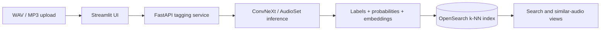

<p align="center">
  
</p>

<p align="center">
  <a href="https://www.python.org/"></a>
  <a href="LICENSE"></a>
  
</p>

**API** is a local, containerized prototype for zero-shot audio annotation and retrieval. It accepts WAV/MP3 uploads through Streamlit, tags them with an AudioSet ConvNeXt model served by FastAPI, and stores labels, probabilities and 768-dimensional embeddings in an OpenSearch k-NN index for label search and similar-audio exploration. It is a prototype; no benchmark results are included.

## Highlights

- WAV and MP3 uploads through a focused Streamlit workflow.
- An AudioSet ConvNeXt model producing zero-shot label probabilities and 768-dimensional scene embeddings.
- Saves clip metadata, labels, probabilities, and vectors to an OpenSearch k-NN index.
- Annotation tables, charts, CSV export, label search, and similar-audio exploration in the UI.
- A three-service Docker Compose stack: Streamlit, FastAPI tagging, and OpenSearch.

## How it works



The tagging service normalizes audio to 32 kHz, prepares fixed-length clips, scores AudioSet labels above its configured threshold, and indexes each clip’s embedding alongside aggregated label data.

## Tech stack

| Area | Tools in this repository |
| --- | --- |
| Inference | PyTorch, Torchaudio, AudioSet ConvNeXt |
| API | FastAPI, Uvicorn |
| Search | OpenSearch with k-NN vectors |
| Interface | Streamlit, Pandas, Altair |
| Deployment | Docker, Docker Compose |

## Installation

Requires Docker with Docker Compose. The tagging service builds on Python 3.10 and the UI on Python 3.9 (both inside their images), so no local Python setup is needed for the stack.

```bash
git clone https://github.com/shreyansh05s/API.git
cd API/src
cp .env.example .env      # then set OPENSEARCH_INITIAL_ADMIN_PASSWORD to a strong password
docker compose up --build
```

The `requirements.txt` files are unpinned and the tagging image installs `audioset-convnext-inf` from a git branch; builds have not been re-verified for this cleanup. For development outside Docker, create a venv (`python -m venv .venv`) and `pip install -r src/<service>/requirements.txt`.

## Usage

- Streamlit UI: http://localhost:8501 (upload audio, view tags, search labels, find similar clips)
- Tagging API: http://localhost:8000
- OpenSearch: https://localhost:9200 (user `admin`, password from `.env`)

The same password is passed to the UI and tagging containers as `OPENSEARCH_PASSWORD`.

## Data

No audio is shipped. Supply your own WAV/MP3 files (`audio/` is git-ignored for local samples). `src/tagging/class_labels_indices.csv` is the AudioSet label list used by the tagger.

## Limitations

- Prototype: OpenSearch runs single-node with TLS verification disabled and no persistent volume.
- Both Python services run with `debug=True`; do not expose them publicly.
- Image tags and Python dependencies are not pinned.

## Project structure

```text
.
├── README.md
├── LICENSE
├── assets/banner.svg
└── src/
    ├── docker-compose.yml
    ├── .env.example
    ├── streamlit-ui/        # Streamlit front end
    ├── tagging/             # FastAPI + ConvNeXt tagging service
    └── indexing/            # Flask embedding/indexing prototype
```

## License

BSD 2-Clause, see [LICENSE](LICENSE).

## Author

Shreyansh Sharma ([@shreyansh05s](https://github.com/shreyansh05s))
