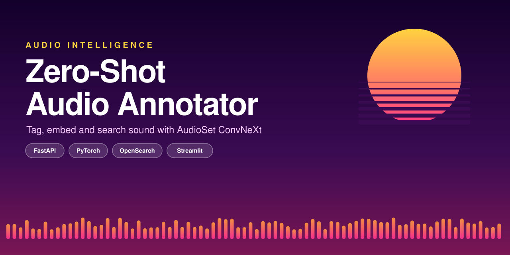
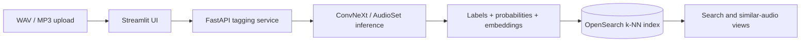

<p align="center">
  
</p>

<p align="center">
  <a href="https://www.python.org/"></a>
  <a href="LICENSE"></a>
  
</p>

**API** documents a local, containerized prototype architecture for zero-shot audio annotation and retrieval. It describes WAV/MP3 upload through Streamlit, AudioSet ConvNeXt tagging through FastAPI, and OpenSearch-based label and similarity exploration. This minimal clone contains the README and banner only, so the implementation cannot be independently verified here.

## Highlights

- Documents WAV and MP3 uploads through a focused Streamlit workflow.
- Describes an AudioSet ConvNeXt model producing zero-shot label probabilities and 768-dimensional scene embeddings.
- Describes saving clip metadata, labels, probabilities, and vectors to an OpenSearch k-NN index.
- Describes annotation tables, charts, CSV export, label search, and similar-audio exploration in the UI.
- Documents a three-service Docker Compose stack: Streamlit, FastAPI tagging, and OpenSearch.

## How it works



The tagging service normalizes audio to 32 kHz, prepares fixed-length clips, scores AudioSet labels above its configured threshold, and indexes each clip’s embedding alongside aggregated label data.

## Tech stack

| Area | Tools in this repository |
| --- | --- |
| Inference | PyTorch, Torchaudio, AudioSet ConvNeXt |
| API | FastAPI, Uvicorn |
| Search | OpenSearch with k-NN vectors |
| Interface | Streamlit, Pandas, Altair |
| Deployment | Docker, Docker Compose |

## Availability

The documented stack uses Streamlit on port `8501`, the tagging service on `8000`, and OpenSearch on `9200`. The Docker Compose and application source referenced below are not included in this minimal clone, so runnable setup steps cannot be verified here.

## Project structure

```text
.
├── README.md                 # Architecture and usage documentation
└── assets/banner.svg         # Repository banner
```

---
